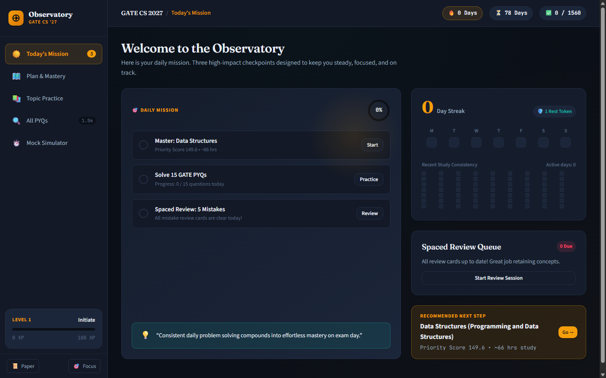
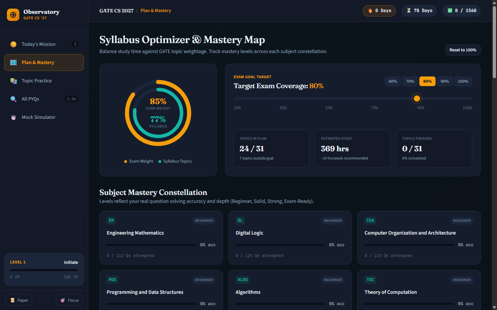
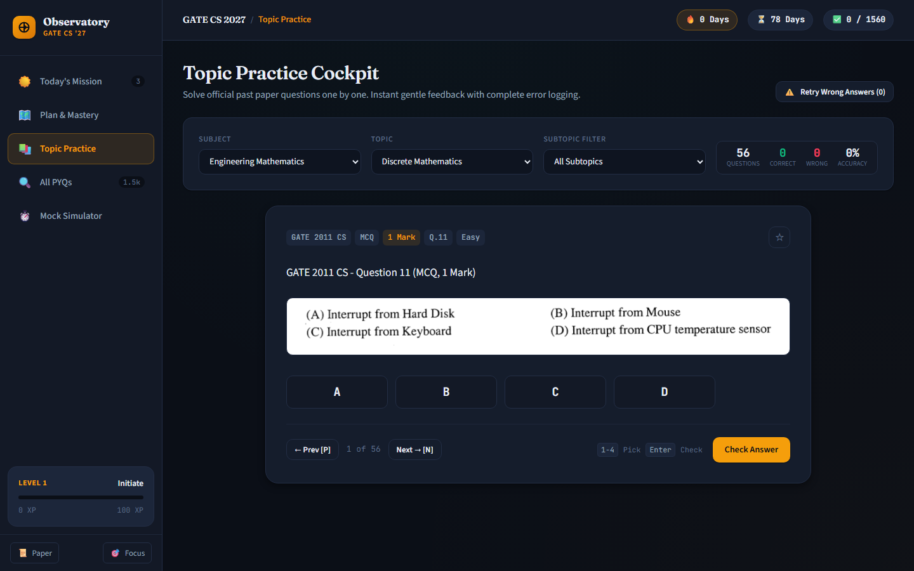
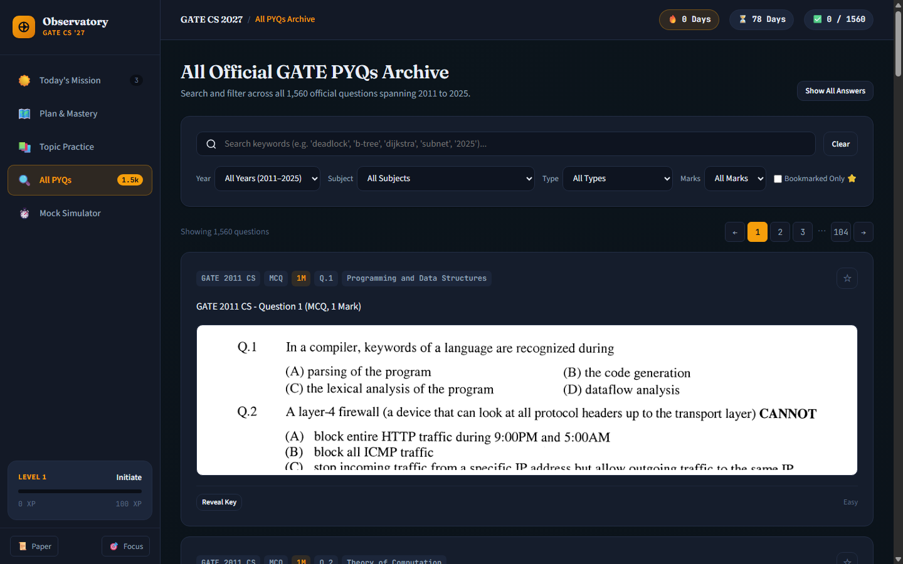
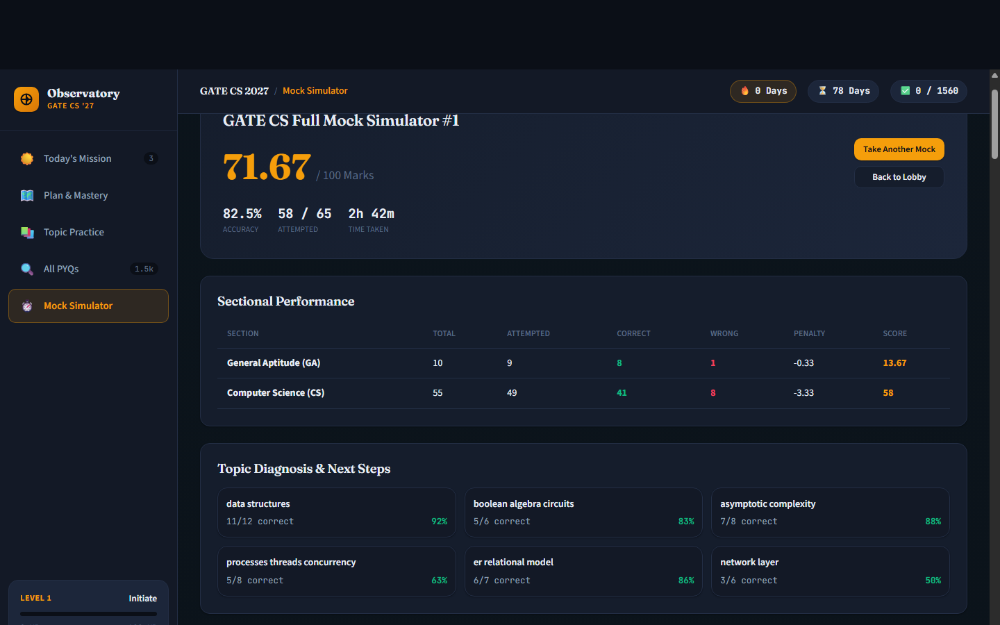
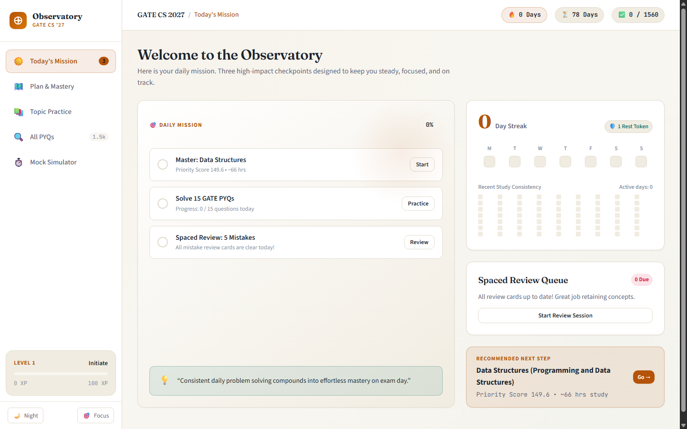

# GATE CS 2027 — Night Observatory 🔭

> An offline-first, distraction-free study environment and mock examination platform for **GATE Computer Science & Information Technology (CS/IT)**, powered by 1,560 official PYQs (2011–2025).

---

## 📸 Interface Showcase

### 1. Today's Mission & Activity Tracking
*Start each session with focused, dynamic goals, active streak counters with forgiving rest tokens, and a GitHub-style study heatmap.*



---

### 2. Strategic Syllabus Plan & Dual-Ring Mastery Chart
*Plan with precision: Adjust the tactile importance-goal slider to automatically prioritize high-yield topics based on PYQ frequency, recency, and marks weightage.*



---

### 3. Topic-Wise Practice & Interactive Feedback
*Solve subject-by-subject with instant correctness feedback, official answer key reveals, and automatic logging of incorrect attempts to your spaced-repetition Error Log.*



---

### 4. All Official PYQs Archive (2011–2025)
*Search across 1,560 official questions with multi-faceted filtering (Year, Subject, Type, Marks, Bookmarks). Supports clickable option pills for both text and diagram/scanned questions.*



---

### 5. Mock Simulator & Diagnostic Performance Analytics
*Real exam conditions with 3-hour countdown timer, official GATE negative marking rules, section-wise timing breakdown, and weak-topic diagnostics.*



---

### 6. Dual Themes: "Night Observatory" & "Paper"
*Switch between the deep ink-navy "Night Observatory" theme for evening study and the warm off-white "Paper" theme for daytime sessions.*



---

## ⚡ Key Highlights

- **100% Client-Side & Private:** Zero backend server, zero tracking. All test results, custom exam dates, bookmarks, and solved states persist in your browser's `localStorage`.
- **Keyboard-Driven Study:** Rapid question solving using keyboard shortcuts (`1`–`4` to pick options, `Enter` to check, `N` for next question, `B` to bookmark, and `Focus Mode` with built-in Pomodoro timer).
- **GATE Scoring Engine:** Exact marking formulas:
  - **MCQ:** $+1$ / $-\frac{1}{3}$ for 1-mark questions, $+2$ / $-\frac{2}{3}$ for 2-mark questions.
  - **MSQ:** $+1$ or $+2$ with strict all-or-nothing evaluation (no negative marking, zero partial credit).
  - **NAT:** Precision range verification with tolerance checks.

---

## 🚀 How to Run Locally

1. Clone or download this repository:
   ```bash
   git clone https://github.com/elrath017/gate-cs-2027.git
   ```
2. Open `index.html` in any modern web browser (Chrome, Edge, Firefox, Safari).
3. **That's it!** No `npm install`, Node.js, or local web server required.

---

## 🌐 Deploy to GitHub Pages (Free)

1. Push this repository to your GitHub account.
2. In your repository, navigate to **Settings** → **Pages**.
3. Under **Build and deployment**:
   - Set **Source** to `Deploy from a branch`.
   - Set **Branch** to `main` and folder to `/ (root)`.
   - Click **Save**.
4. Your study app will be live at `https://<your-username>.github.io/<repo-name>/`.
